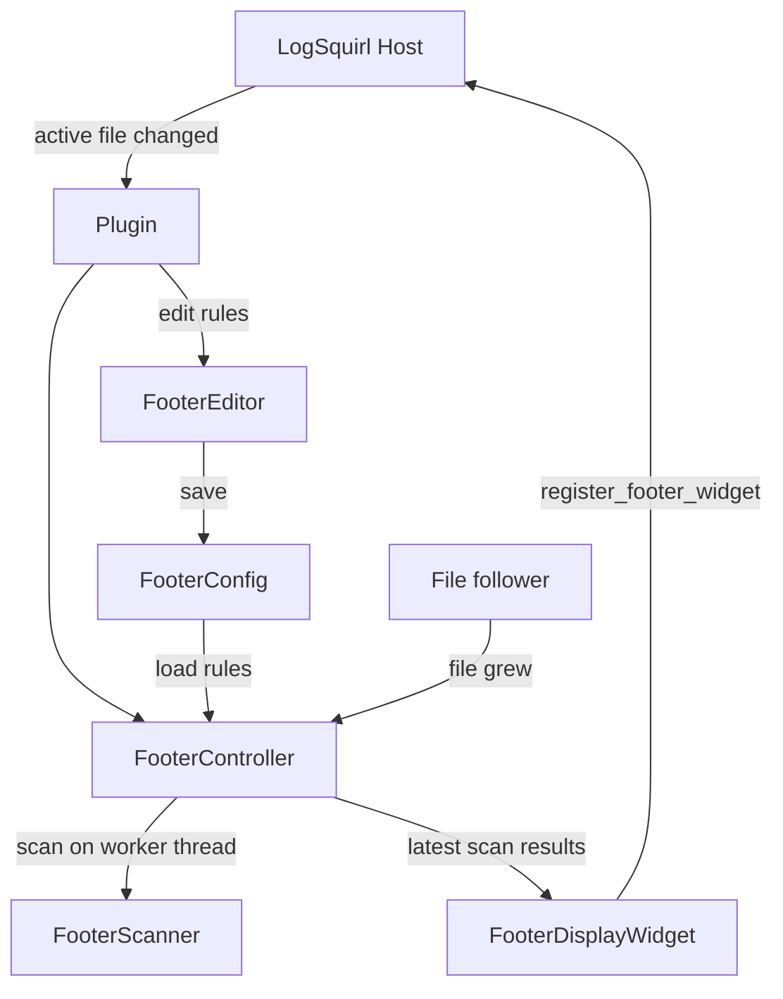
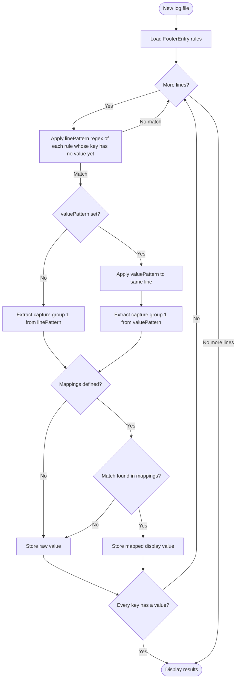

<!-- Allow GitHub's presentation markup and a logo before the main heading. -->
<!-- markdownlint-configure-file {"MD033": {"allowed_elements": ["div", "img"]}, "MD041": false} -->

<div align="center">


# Custom Footer

**The values you care about, always in view.**

**A [LogSquirl](https://github.com/64x-lunicorn/LogSquirl) plugin that lifts
key-value pairs out of a log and pins them to a footer bar.**

Write a regex rule once — build number, VIN, session id, firmware version — and
it stays on screen while you scroll through everything else.

[](https://github.com/64x-lunicorn/LogSquirl-CustomFooter/actions/workflows/ci-build.yml)
[](https://github.com/64x-lunicorn/LogSquirl-CustomFooter/releases/latest)
[](https://github.com/64x-lunicorn/LogSquirl-CustomFooter/releases)
[](#install)
[](LICENSE)

[Install](#install) &nbsp;/&nbsp;
[Configuration](#configuration) &nbsp;/&nbsp;
[Build](#build) &nbsp;/&nbsp;
[Architecture](#architecture) &nbsp;/&nbsp;
[Changelog](CHANGELOG.md)

</div>

---

## Why this plugin?

Some facts about a log are true for the whole file, not for one line: which
build produced it, which vehicle, which session. Searching for them again every
time you scroll is wasted motion. This plugin extracts them once and keeps them
in the footer.

| Write the rule | Read the answer |
| :--- | :--- |
| **Regex extraction.** A rule matches a line and captures the value you want from it. | **Always on screen.** Results sit in a compact bar along the bottom of the main window; a click copies a value. |
| **Two-stage matching.** An optional second regex runs against the matched line, for when the value needs a finer cut than the line pattern gives. | **Readable values.** Map raw captures to display text, so `0x04` can read as `Production`. |
| **Rules you can share.** Import and export rule sets as JSON, per project or per team. | **Edited in one place.** Rules are managed in a dialog: a list of all rules, and a panel with the patterns and value mappings of the selected one. |

## Install

### From LogSquirl

*Plugins → Browse Plugins…* → **Custom Footer** → **Install**. The archive is
downloaded, verified against its SHA-256 checksum and loaded — no file copying.

### From a release

Download the archive for your platform from the
[releases page](https://github.com/64x-lunicorn/LogSquirl-CustomFooter/releases/latest)
and unpack it into LogSquirl's plugin directory:

| Platform | Plugin Directory |
|----------|-----------------|
| macOS    | `~/Library/Application Support/logsquirl/plugins/io.github.logsquirl.customfooter/` |
| Linux    | `~/.local/share/logsquirl/plugins/io.github.logsquirl.customfooter/` |
| Windows  | `%APPDATA%/logsquirl/plugins/io.github.logsquirl.customfooter/` |

### From source

See [Build](#build), then:

```bash
DEST="$HOME/Library/Application Support/logsquirl/plugins/io.github.logsquirl.customfooter"
mkdir -p "$DEST"
cp build/liblogsquirl_custom_footer.dylib "$DEST/"
cp plugin.json icon.png "$DEST/"
```

After installing, restart LogSquirl or re-scan via *Plugins → Manage Plugins…*.

## Configuration

Rules are edited in *Plugins → Custom Footer…* (on LogSquirl 26.11,
*Plugins → Custom Footer → Edit Rules…*). The dialog lists the rules on the
left, each with its enabled check box, key and line pattern, with buttons to
add (also from a template or a selected Log Line), remove, reorder, import
and export them. The panel on the right shows the selected rule: its key,
line pattern, value pattern and value mappings. Changes show up in the list
as you type.

Order matters: among rules sharing a key, the one higher in the list wins on
the same line. Reorder rules by dragging them in the list, with the ↑/↓
buttons, or with Ctrl+Shift+Up / Ctrl+Shift+Down (⇧⌘↑ / ⇧⌘↓ on macOS) while
the list has the focus. A rule keeps its mappings, enabled state and
validation marks wherever it is moved, and stays selected.

Below the fields, a **live preview** shows what the selected rule finds in
the active log file, without applying it: the first matching line and its
number, with the line pattern's match and the value highlighted; the raw
value and the value after mappings; and how many lines match, e.g. "12
matching lines in the first 100,000 lines", within the same limits as the
footer. For a key that several rules share, it says whether this rule or
another one supplies the value in this file. It updates shortly after you
stop typing and scans in the background, so the editor never waits for
it, and it follows the log as it grows. Without an open log file, while
a pattern is invalid, or while a simple rule is unfinished, it explains
why instead.

Rules are persisted in `custom_footer.ini` inside the plugin's config directory.

### Simple and advanced mode

Most rules need no regex. In **simple mode** a rule is described by:

- the **text before the value**, e.g. `VIN:`, matched literally — `[`, `.`,
  `(` or `\` are just characters — with any whitespace after it ignored;
- where the **value ends**: at whitespace (one word, the default), at the
  end of the line (without trailing whitespace), or before a given
  character, e.g. `,` or `;` (without the whitespace before it). The
  character may be any single character, emoji included, but not a control
  character such as a tab; until it is entered, the rule is marked and the
  rules cannot be saved.

Whitespace means ASCII whitespace, such as spaces and tabs, as `\s` in the
patterns: a no-break space or an ideographic space is part of the value.

The line pattern is generated from these and shown read-only; a simple rule
needs no value pattern. `VIN:` with the value ending at whitespace becomes
`VIN:\s*(\S+)`: only regex metacharacters are escaped. New rules start in
simple mode, and a hand-written rule like `VIN:\s*(\S+)` opens in it.

Check **Advanced** to edit the line and value patterns directly; the
generated patterns are kept. Switching back is offered only while the
patterns still have exactly the form simple mode generates. When the editor
opens, a rule whose patterns have that form is shown in simple mode, every
other rule in advanced mode. Simple rules are saved as their patterns, so the
config and JSON formats do not change.

### Testing a pattern in the Regex Lab

**Test…** next to the line pattern and next to the value pattern opens the
pattern in LogSquirl's **Regex Lab**, to try it against sample lines and
change it there. **Apply** in the Lab puts the pattern into the rule, just as
if you had typed it: the validation marks and the live preview follow, and
it is saved with OK or Apply in the editor. **Cancel**, or closing the Lab,
changes nothing.

- Rules have no "match case" setting of their own: they match case unless
  the pattern starts with `(?i)`. The Lab opens with **Match case** on, or
  off for a pattern starting with `(?i)` (shown without it). If you apply
  with Match case off, the rule's pattern gets `(?i)` in front (after
  start-of-pattern items such as `(*CRLF)`, which must come first).
- Applying the pattern exactly as the Lab opened with it changes nothing.
- In simple mode, Test… of the line pattern opens the generated pattern.
  Applying it unchanged keeps the rule simple; applying a changed pattern
  switches the rule to Advanced with that pattern, as editing it by hand
  would. A simple rule has no value pattern, so its Test… is disabled.
- One Lab is open for the editor at a time; Test… is disabled until you
  apply or cancel it. The pattern goes to the rule you opened the Lab for,
  even if you select another rule or move it meanwhile. If you remove that
  rule, or close the editor, before applying, the Lab's pattern is not used.
- Test… needs LogSquirl 26.11 or later. On older versions it is disabled
  and says so in its tooltip; everything else works as before.

### Rule templates

**From template…** next to the add button adds ready-made rules to adjust
instead of writing them. The templates are listed under their group; check
the ones you want, or a whole group to check all its templates (Space or a
double-click checks one too), and click **Add Rules**. Each checked
template becomes a new rule, after the existing rules and in the order the
dialog lists them, and the first new rule is selected; no existing rule
changes. A template only makes new rules: a rule made from one earlier
keeps its patterns, key and mappings when the template changes.

| Group | Template | Key | Finds | Mode |
|-------|----------|-----|-------|------|
| General | Version | `Version` | The number after `version` or `ver` in any case, also after `_` or in camel case (`app_version=1.2.3`, `appVersion: 2.1.0`), with optional quotes, `:`, `=`, `>` or `.` and `v` between (`Version: v2.0.1-rc1` → `2.0.1-rc1`, `{"version": "1.2.3"}`, `<version>1.2.3`, `Ver. 2.1`), or after a `v` starting a word when it has a dot (`v1.2.3`). A suffix like `-rc1`, `-beta.2` or `+build.5` is part of it; a date is not. The `version` of an XML declaration (`<?xml version="1.0"`) is skipped. | Advanced |
| General | Build number | `Build` | The word after `Build:` (`Build: 1234`) | Simple |
| General | Serial number | `Serial number` | The word after `Serial number:` | Simple |
| General | Environment | `Environment` | The word after `env:` (`env: prod`, `env: staging`) | Simple |
| General | User | `User` | The word after `user:` (`user: alice`) | Simple |
| General | Log start | `Log start` | When the log starts: the first date and time in the file, as the first match counts. ISO 8601: `2024-01-15T10:30:00Z`, with `T` or a space, optional seconds, fraction and `Z` or an offset of `±HH`, `±HHMM` or `±HH:MM`, `t` and `z` in lower case too. Truncated fields such as `10:30:5` or `+01:0` are not matched; a `:` after a complete timestamp (`10:30:00: started`) is fine. | Advanced |
| General | `key=value` | the key you give | The value right after `<key>=`, up to the next whitespace, as in logfmt. Also as a flag, `-user=` or `--user=`. Not in a longer key (`superuser=`, `a.user=`, `my-user=`), and `user= x` has no value. | Advanced |
| Network | IPv4 address | `IP address` | The word after `IP:` (`IP: 192.168.1.20`), not the first address in a line, which in a log with clients and servers is an arbitrary one | Simple |
| Linux and boot | Kernel version | `Kernel` | The word after `Linux version` in dmesg (`Linux version 6.8.0-45-generic (buildd@…) …` → `6.8.0-45-generic`) | Simple |
| Linux and boot | Hardware (DMI) | `Hardware` | Vendor, product and board before `, BIOS` in the `DMI:` line (`DMI: LENOVO 20XW0055GE/20XW0055GE, BIOS N32ET86W (1.62 ) 06/26/2023` → `LENOVO 20XW0055GE/20XW0055GE`); a comma in the product is kept. `DMI: not present or invalid.` is not taken. | Advanced |
| Linux and boot | Kernel command line | `Command line` | The rest of the line after `Command line:` (`Command line: BOOT_IMAGE=/boot/vmlinuz-6.8.0-45-generic root=UUID=… ro quiet splash`) | Simple |
| Linux and boot | U-Boot version | `U-Boot` | The version in the U-Boot banner (`U-Boot 2024.01 (Mar 11 2024 - 18:45:23 +0000)` → `2024.01`), not the SPL or TPL banner | Advanced |
| Linux and boot | Syslog host | `Host` | The host after the time at the start of an RFC 3164 syslog line, with or without `<PRI>` (`Oct 13 08:12:01 webserver01 sshd[1234]: …` → `webserver01`); also journalctl's default output | Advanced |
| Android | Build fingerprint | `Build fingerprint` | The build fingerprint by its shape, `brand/product/device:version/id/incremental:type/tags` with type `user`, `userdebug` or `eng` (`google/sunfish/sunfish:11/RQ3A.210805.001.A1/7474174:user/release-keys`), as in a tombstone, a crash in logcat (`Build fingerprint: '…'`), a bug report or getprop. Not inside a path. | Advanced |
| Android | Device model | `Device model` | The value of `ro.product.model` in getprop output, spaces included (`[ro.product.model]: [Pixel 7]` → `Pixel 7`) | Simple |
| Android | Android version | `Android version` | The value of `ro.build.version.release` in getprop output (`[ro.build.version.release]: [14]`) | Simple |
| Android | Device serial number | `Serial number` | The value of `ro.serialno` in getprop output (`[ro.serialno]: [28031FDH2004VT]`) | Simple |
| Network | MAC address | `MAC address` | The address after `MAC:`: six pairs of hex digits separated by `:` or `-`, the same separator throughout (`52:54:00:12:34:56`, `00-1A-2B-3C-4D-5E`), or three groups of four separated by `.` (`0050.56a1.b2c3`), in either case. A longer address or mixed separators are not matched. | Advanced |
| Network | IPv6 address | `IPv6 address` | The address after `IPv6:`, in full or shortened with `::` (`2001:db8::1`, `::1`), also with an IPv4 address as its last part (`::ffff:192.0.2.10`). A prefix length (`/64`) or zone (`%eth0`) after it is not part of the value. | Advanced |
| Test run | Python version | `Python` | The Python version in the pytest header, after `-- Python` up to the comma (`platform linux -- Python 3.12.3, pytest-8.3.2, pluggy-1.5.0` → `3.12.3`); on PyPy with the PyPy version (`3.9.10[pypy-7.3.8-final]`) | Simple |
| Test run | pytest version | `pytest` | The pytest version in the pytest header, after `, pytest-` up to the comma (`8.3.2`), not in a temporary path like `/tmp/pytest-of-user/pytest-3` | Simple |
| Test run | Test result | `Test result` | The summary at the end of a pytest run, without the `=` around it: `=== 3 failed, 120 passed in 12.30s ===` → `3 failed, 120 passed in 12.30s`, also `no tests ran in 0.01s`, a duration after a long run (`in 336.42s (0:05:36)`), `in 0.03 seconds` from pytest before 5.1, and the line `pytest -q` writes without `=` | Advanced |

The Test run templates are meant for one pytest run per file: with
several runs, the footer shows the versions and the result of the first.
| CI | Runner image | `Runner image` | The GitHub Actions runner image after `Image:` in *Set up job* (`Image: ubuntu-24.04`) | Simple |
| CI | Runner image version | `Runner image version` | The GitHub Actions runner image version after `Version:`: a date and two numbers (`Version: 20261004.327.1`), so the two-part `Version:` of the Runner Image Provisioner before it is skipped | Advanced |
| CI | Commit | `Commit` | The commit after `HEAD is now at` (`HEAD is now at aa5a02d Merge …` → `aa5a02d`); with several checkouts in the log, the first | Simple |
| CI | GitLab Runner version | `GitLab Runner version` | The version after `Running with gitlab-runner` (`Running with gitlab-runner 16.2.0 (782e15da)` → `16.2.0`) | Simple |
| CI | Started by | `Started by` | The Jenkins user after `Started by user`, up to the end of the line (`Started by user Jane Doe` → `Jane Doe`); nothing for `Started by timer` | Simple |

The runner image templates fit job logs of GitHub-hosted runners; a
self-hosted runner prints no Runner Image section.
| iOS crash log | Hardware model | `Hardware model` | The word after `Hardware Model:` (`Hardware Model: iPhone15,5` → `iPhone15,5`) | Simple |
| iOS crash log | OS version | `OS version` | The rest of the line after `OS Version:` (`OS Version: iPhone OS 17.2 (21C62)` → `iPhone OS 17.2 (21C62)`, also `macOS 14.6.1 (23G93)`) | Simple |
| iOS crash log | Incident identifier | `Incident identifier` | The word after `Incident Identifier:`, the report's UUID | Simple |
| iOS crash log | App version | `App version` | The rest of the line after `Version:` (`Version: 1.0 (1)` → `1.0 (1)`, the app's CFBundleVersion and CFBundleShortVersionString), not after a word and a space, so `OS Version:`, `Baseband Version:` and `Report Version:` are not taken when the app's `Version:` is empty | Advanced |

The iOS crash log templates fit the text form of a crash report (a
`.crash` file, or the translated report at the top of an `.ips` file),
from macOS too; the JSON of an untranslated `.ips` file is not matched.
| Java and Spring Boot | Application | `Application` | The application of the Spring Boot start line, `Starting MyApp v1.2.0 using Java 17.0.8 with PID 4242 (…)` → `MyApp`, in the wording of Spring Boot 2 and 3, also `Starting AOT-processed MyApp`. Not `Starting service [Tomcat]` or other lines that start something. | Advanced |
| Java and Spring Boot | Application version | `Application version` | The version after `v` in the Spring Boot start line (`v1.2.0` → `1.2.0`); none if the application has no version | Advanced |
| Java and Spring Boot | Java version | `Java version` | The word after `using Java` (`using Java 17.0.8`), in the start line of Spring Boot 2.4 and later | Simple |
| Java and Spring Boot | Host | `Host` | The host between `on` and `with PID` in the Spring Boot 2 start line (`… on myhost with PID 4242`); Spring Boot 3 no longer logs it | Advanced |
| Java and Spring Boot | Active profile | `Active profile` | The active Spring profiles: `The following 1 profile is active: "prod"` → `prod`; several as listed (`"dev", "local"`, or `dev,local` before Spring Boot 2.7). Not the default profile of `No active profile set, falling back to …`. | Advanced |
| Java and Spring Boot | JRE version | `JRE version` | The runtime version in `(build …)` of the `# JRE version:` line of a JVM crash log (`hs_err_pid*.log`), `… (build 17.0.8+7)` → `17.0.8+7`; none if the JVM crashed while starting and left it empty | Advanced |
| Automotive | VIN | `VIN` | A VIN by its shape alone, with or without text before it (`VIN: WVWZZZ1JZXW000001`, `"vin": "1M8GDM9AXKP042788"`): 17 characters from `A`–`Z` and `0`–`9` without `I`, `O` and `Q`, with both letters and digits, not part of a longer word; `_` and punctuation may border it. Upper case only, and no check digit test, as only North American VINs have one. | Advanced |
| Automotive | IMEI | `IMEI` | The word after `IMEI:` (`IMEI: 490154203237518`) | Simple |
| Automotive | ICCID | `ICCID` | The word after `ICCID:` (`%XICCID: 89014103211118510720`) | Simple |
| Automotive | Manufacturer | `Manufacturer` | The first three characters (the WMI) of a VIN the VIN template finds, mapped to the manufacturer for common WMIs (`WVWZZZ1JZXW000001` → `Volkswagen`, `WBA…` → `BMW`); an unmapped WMI shows as it is (`1M8GDM9AXKP042788` → `1M8`) | Advanced |
| Automotive | Model year | `Model year` | The 10th character of a VIN the VIN template finds, mapped to the model year (`WBA3A5C51CF256985` → `2012`). The codes repeat every 30 years; the mappings give 2010 to 2039, so `K` reads `2019` even for a vehicle from 1989. | Advanced |

The Automotive templates fit the log of one vehicle or telematics unit:
the footer shows the first VIN, IMEI or ICCID in the file, and the
manufacturer and model year of that VIN.

A template can bring value mappings, as Manufacturer and Model year do:
the new rule has them like mappings you add yourself, shown in the editor,
editable, and saved with the rule. Add a mapping for a WMI that is
missing, or change a model year that belongs to the earlier cycle.

Simple templates match their text as written, case included, so change
`Build:`, `IP:`, `env:`, `user:`, `IMEI:` or `ICCID:` to what your log
says; the text may also end a longer word (`ClientIP:`, `superuser:`,
`%XICCID:`), so make it as long as needed to say which value you mean.
MAC address and IPv6 address need the address's shape and open in advanced
mode; their pattern starts with the text, `MAC:` or `IPv6:`, which you
change there in the same way (`link/ether`, `inet6`). Version does not
count `version` inside
another word (`conversion`, `server`), and so also misses a lower-case
`appversion`; `app_version` and `appVersion` are found. For `key=value`,
give the key without `=` (a trailing `=` is dropped); while it is checked,
the dialog asks for the key and **Add Rules** stays disabled until one is
given. For lists separated by `;` or `,`, change `(\S+)` in the pattern to
`([^;]+)`. If an enabled rule with a line pattern already has the key of a
checked template, the dialog names every such key: each new rule with one
of them becomes an alternative for that key.

Syslog host takes the host of the first line, so it fits the log of one
host, not one merged from several. ARM kernels write `Kernel command line:`
instead of `Command line:`; change the text of Kernel command line to it.
The Android getprop templates read the `[key]: [value]` lines of `adb shell
getprop` and of a bug report, not `build.prop` (`ro.product.model=…`).

### Rule from a selected line

On LogSquirl 26.11 or later, select the Log Line that holds the value and
choose *Plugins → Custom Footer → Rule from Selected Line…*. (There the
editor itself is *Plugins → Custom Footer → Edit Rules…*.) The rule editor
opens, or comes forward with your edits kept, with a new rule in simple
mode, and shows the line above the rule's fields. Click where the value
starts, or mark the value with the mouse:

- the text before the value becomes **text before the value**: the word
  right before it (`VIN:`), with the word before that if it is only a
  separator (`id =`);
- **value ends at** follows from the mark: whitespace for one word, the
  character after the value (e.g. `,` in `speed=5,rpm=300`), or the end of
  the line for a value with spaces in it;
- the **key** is suggested from that text (`VIN:` → `VIN`, `[VIN]` →
  `VIN`, `app.version=` → `app.version`). A key you type yourself is kept
  when you mark another value.

The preview shows the extracted value at once. A click marks the whole
word it lands in; spaces around a mark are not part of the value. Of a very
long line only the first 64 KiB are shown, as the footer reads no further.
Some marks make no rule, and the editor says why: a value at the very
start of the line has no text before it, and a value whose text before it
also appears earlier in the line would never be found, as a rule takes the
first match (`a: 1 a: 2` marking `2`). Mark another value then, or write an
advanced rule.

Like every rule, the new one gives its key the value of the **first** Log
Line in the file it matches, not necessarily the selected one. If an
earlier Log Line matches first, the editor says which one and what the
footer will show.

When several lines are selected, the rule is made from the first, and the
editor says so. The editor's **From selected line…** button does the same
with the line selected when the editor opened: while the editor is open,
LogSquirl's window, and so its selection, cannot change. Without a selected
line or an open Log File, a message says what to do. While the Regex Lab is
open for the editor, marks in the line are not taken. LogSquirl 26.10 does
not offer the selected line: there the menu has *Plugins → Custom Footer…*
as before, and the button is not shown.

### How rules are applied

- Each key takes its value from the **first line** of the file that one of
  its rules matches. Rules may share a key as **alternatives**, e.g. one
  pattern for old logs and one for new ones: whichever matches first in the
  file provides the value, and if several match the same line, the one
  higher in the list wins. The key is shown once, where its first rule is.
- A rule without a line pattern is ignored. The editor marks invalid
  patterns, and enabled rules with a line pattern but no key, at the field
  with the reason and in the rule list, and won't save until they are fixed.
- The file is scanned in the background whenever it becomes the active file
  and when rules are applied. A rule the editor would mark, e.g. with an
  invalid pattern, is skipped and reported in the LogSquirl log in the
  editor's words, such as `Rule 2: invalid line pattern: …`.
- The active file is **watched**: when it changes, e.g. while following a
  growing log, it is scanned again about half a second later, so values
  that show up later in the file appear in the footer. A change during a
  scan is scanned half a second after that scan, never right after it.
  Only the lines appended since the last scan are read, and none once
  every key has a value; a file that was truncated or replaced is scanned
  from its start. If the file is rotated away, the footer picks it up
  again once it is recreated.
- **Copy a value** by clicking it in the footer: exactly the value is copied,
  not its key, and a short "Copied" tooltip confirms it. Hover a value to see
  which rule supplied it and, for a mapped value, the raw value it replaced.
  With the keyboard, Tab to a value and press Space, Return or the copy
  shortcut. The context menu of a value offers "Copy Value", "Copy Key and
  Value", and "Copy All" for every key and value shown, one per line.
- **Go to the Log Line of a value** (LogSquirl 26.11 or later) by
  double-clicking it, or with "Go to Log Line" in its context menu (with
  the keyboard: Tab to the value and press the context menu key). LogSquirl
  selects the line the value was found in and scrolls to it in the tab in
  front; the tooltip of a value names that line. For a key that several
  rules share, it is the line that supplied the shown value. If the line is
  no longer in the file, a short tooltip says so. A double-click copies
  the value too, as its first click does. On LogSquirl 26.10 the values
  only copy.
- A scan stops after `scan/maxLines` lines (default 100000, `0` for no
  limit) and never reads more than 64 MiB; lines longer than 64 KiB are
  matched against their start.

### INI Format (internal)

```ini
[entries]
1\key=VIN
1\linePattern=VIN:\\s+(\\S+)
1\valuePattern=
1\enabled=true
1\mappings\size=0

2\key=Component Protection
2\linePattern=isComponentProtectionEnabled
2\valuePattern=:\\s+(\\S+)$
2\enabled=true
2\mappings\1\pattern=true
2\mappings\1\display=Enabled
2\mappings\2\pattern=false
2\mappings\2\display=Disabled
2\mappings\size=2
```

### JSON Format (import / export)

```json
{
  "version": 1,
  "entries": [
    {
      "key": "VIN",
      "linePattern": "VIN:\\s+(\\S+)",
      "valuePattern": "",
      "enabled": true,
      "mappings": []
    },
    {
      "key": "Component Protection",
      "linePattern": "isComponentProtectionEnabled",
      "valuePattern": ":\\s+(\\S+)$",
      "enabled": true,
      "mappings": [
        { "pattern": "true",  "display": "Enabled" },
        { "pattern": "false", "display": "Disabled" }
      ]
    }
  ]
}
```

## Prerequisites

- **LogSquirl** ≥ 26.03 with the plugin system enabled
- **Qt6** (Core + Widgets) — same version LogSquirl was built with; the
  tests also need Qt Test
- **CMake** ≥ 3.16
- A C++17-capable compiler (GCC ≥ 9, Clang ≥ 14, MSVC ≥ 19.29)

## Build

```bash
# Clone
git clone https://github.com/64x-lunicorn/LogSquirl-CustomFooter.git
cd LogSquirl-CustomFooter

# Configure
cmake -B build -S . -DCMAKE_BUILD_TYPE=Release

# If Qt6 is not in PATH (e.g. Homebrew on macOS):
cmake -B build -S . -DCMAKE_BUILD_TYPE=Release \
  -DCMAKE_PREFIX_PATH="$(brew --prefix qt6)"

# Build
cmake --build build --parallel

# The shared library is in build/:
#   macOS:   build/liblogsquirl_custom_footer.dylib
#   Linux:   build/liblogsquirl_custom_footer.so
#   Windows: build/logsquirl_custom_footer.dll
```

### Running Tests

```bash
cmake -B build -S . -DCMAKE_BUILD_TYPE=Release -DBUILD_TESTS=ON
cmake --build build --parallel
cd build && ctest --output-on-failure
```

## Architecture



## Rule Evaluation Flow



## License

GPL-3.0-or-later — see [LICENSE](LICENSE) for the full license text.

The vendored `include/logsquirl_plugin_api.h` header is MIT-licensed, so
plugins of any license can build against the LogSquirl Plugin SDK without
taking on GPL obligations. See [NOTICE](NOTICE) for details.
